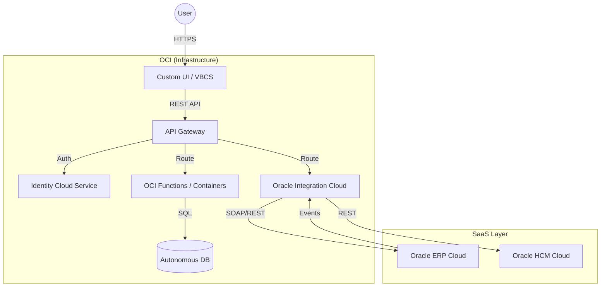

When I first started working with the Oracle stack, it felt like learning a new language. There are so many acronyms (ATP, OIC, VBCS, IDCS, SaaS) that it's easy to lose track of how data actually moves.

After building solutions across these boundaries, I've developed a mental model of how the ecosystem fits together.

## The Big Picture

At a high level, almost every modern Oracle architecture follows this pattern:

1.  **The Core (SaaS/ERP):** Where the business data lives (Finance, HR, Supply Chain).
2.  **The Brain (OIC):** The nervous system that connects everything.
3.  **The Muscle (OCI):** The raw infrastructure where custom apps and databases run.
4.  **The Face (VBCS/Next.js):** The user interface.

Here is how a typical "Extend and Integrate" architecture looks:

## 1. The Nervous System: Oracle Integration Cloud (OIC)

OIC is the glue. In the diagram above, you'll see it sits right in the middle.

Why? Because **Oracle SaaS (ERP/HCM)** is a fortress. You don't just "query the database" of the ERP directly. That's forbidden.

Instead, you use OIC.
*   **Inbound:** OIC has pre-built adapters to push data *into* the ERP (e.g., "Create Invoice").
*   **Outbound:** When something happens in the ERP (e.g., "New Employee Hired"), it fires a Business Event. OIC listens for this event and triggers downstream actions.

## 2. The Muscle: OCI & Autonomous Database (ATP)

Sometimes, the ERP is too rigid. You need a custom table to track "Employee T-Shirt Sizes" or "Temporary Project Status". You can't easily add that to the ERP.

This is where **Autonomous Transaction Processing (ATP)** comes in. It's a fully managed Oracle Database running on OCI.

*   **The Pattern:** You sync core data (Employees) from the ERP into your custom ATP database using OIC.
*   **The Benefit:** Now you have a local, fast copy of the data that you can extend, query, and join with other custom tables.

## 3. The Front Door: API Gateway & IDCS

Security in the enterprise is paramount. You never expose your database or even your OIC flows directly to the internet.

**OCI API Gateway** acts as the bouncer. It works hand-in-hand with **IDCS (Identity Cloud Service)**.
*   The user logs in via SSO (Single Sign-On).
*   The API Gateway validates their token.
*   Only valid requests are allowed to pass through to OIC or your Functions.

## Why This Matters

Understanding this flow—from the User, through the Gateway, orchestrated by OIC, grounded in ATP, and synced with SaaS—is the key to being a "Full Stack" Oracle developer.

You aren't just writing code; you are choreographing a dance between massive, distributed systems. And when it works seamlessly, it's a thing of beauty.

