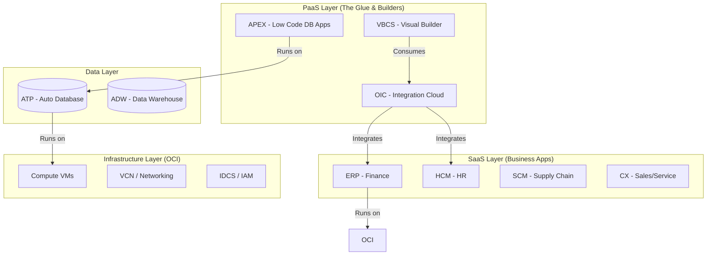

If you are new to the Oracle ecosystem, the first hurdle isn't the technology—it's the vocabulary.

Oracle has a product for almost everything, and they all have three-or-four letter acronyms. It’s easy to get lost.

Here is the mental model I use to categorize the "Red Stack," from the metal up to the user interface.

## The Visual Map

Before diving into definitions, here is how the layers actually stack on top of each other.

## 1. The Foundation: Infrastructure (OCI)

Everything starts here. **Oracle Cloud Infrastructure (OCI)** is the public cloud platform, competing directly with AWS and Azure.

*   **Compute & Storage:** VMs, Bare Metal servers, Object Storage.
*   **Networking:** VCNs (Virtual Cloud Networks), Load Balancers.
*   **Identity (IAM/IDCS):** This is the bouncer. It handles Single Sign-On (SSO) and permissions. If you can't log in, it's an IDCS issue.

## 2. The Data Layer

Oracle is a database company at heart.

*   **Oracle Database:** The classic relational engine.
*   **ATP (Autonomous Transaction Processing):** The "Self-Driving" database. It patches itself, tunes itself, and backs itself up. Perfect for custom apps.
*   **ADW (Autonomous Data Warehouse):** The cousin of ATP, but optimized for massive analytics queries rather than quick transactions.

## 3. The "Glue" & Builders (PaaS)

This is where developers live. These tools let you build custom logic and connect systems.

*   **OIC (Oracle Integration Cloud):** The nervous system. It connects System A to System B. It has pre-built adapters for almost everything (Shopify, Salesforce, SAP, Oracle ERP).
*   **APEX (Application Express):** A low-code platform that runs *inside* the database. You write SQL, and it generates a beautiful, secure web app. It is shockingly fast for internal tools.
*   **VBCS (Visual Builder):** A drag-and-drop web/mobile app builder. Unlike APEX, it focuses on consuming REST APIs rather than talking directly to the DB.

## 4. The Business Applications (SaaS)

These are the massive, pre-built applications that run companies. Collectively, they are often called "Fusion Cloud."

*   **ERP (Enterprise Resource Planning):** The Finance brain. General Ledger, Invoices, Procurement.
*   **HCM (Human Capital Management):** All things HR. Hiring, Payroll, Benefits.
*   **SCM (Supply Chain Management):** Inventory, Manufacturing, Logistics.
*   **CX (Customer Experience):** Sales, Service, and Marketing (CRM).
*   **EPM (Enterprise Performance Management):** High-level budgeting and financial forecasting.

## How It All Fits Together

A typical modern architecture might look like this:

1.  **OCI** provides the secure network and servers.
2.  **ATP** stores custom data that doesn't fit in the standard ERP tables.
3.  **APEX** provides a dashboard for managers to view that custom data.
4.  **OIC** listens for an event in **HCM** (e.g., "New Hire") and automatically creates a user in the **ATP** database.

Understanding this hierarchy helps you know exactly which tool to reach for when solving a problem.
